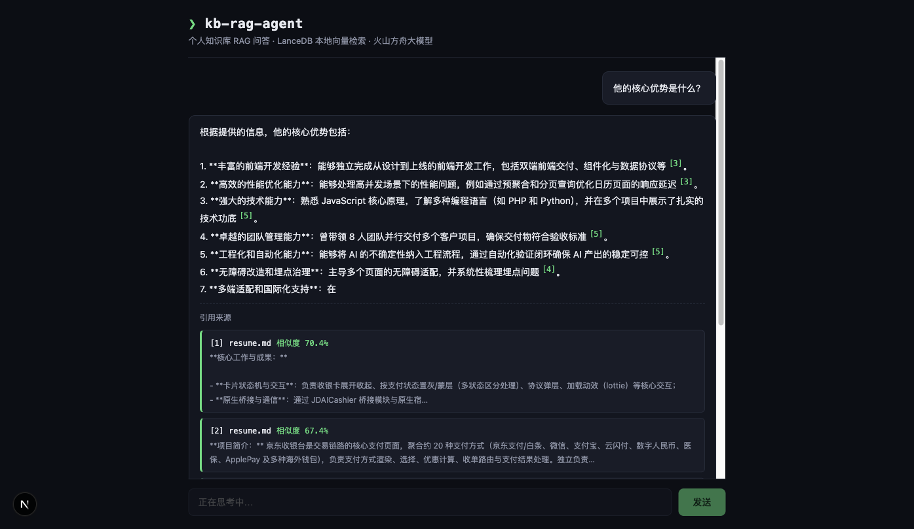
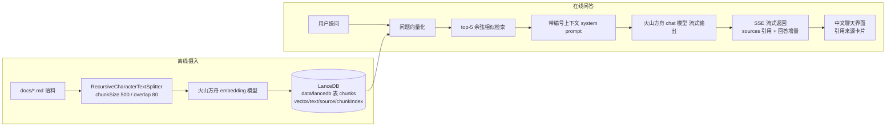

# kb-rag-agent — 个人知识库 RAG 问答

基于 Next.js 15 + LangChain.js + LanceDB 的个人知识库问答应用：把 `docs/*.md` 语料切块、向量化存入本地 LanceDB，提问时做 top-5 相似检索，再由大模型（火山方舟 / 本地 Ollama 均可）流式生成带引用标注 [1][2] 的回答。



## 架构



要点：

- **零外部服务依赖的向量库**：LanceDB 嵌入式，数据落在 `./data/lancedb`，clone 下来即可本地跑通。
- **可重复摄入**：`npm run ingest` 先 drop 旧表再重建，幂等运行。
- **拒答机制**：检索结果最高相似度低于阈值（0.3）时直接回答「知识库中没有相关信息」，不调用大模型、不硬编。
- **SSE 流式协议**：`/api/chat` 返回 `text/event-stream`，依次下发 `sources`（引用来源数组）、`delta`（回答增量）、`done` 三类事件。

## 技术栈

- Next.js 15（App Router）+ TypeScript + React 19
- LangChain.js：`@langchain/core` / `@langchain/openai`（OpenAI 兼容客户端接火山方舟）/ `@langchain/textsplitters`
- 向量库：`@lancedb/lancedb`（嵌入式）
- 模型服务（二选一，env 切换）：
  - 火山方舟 OpenAI 兼容端点（chat：`deepseek-v4-1-flash-261017`，embedding：`doubao-embedding-large-text-250515`）
  - **本地 Ollama（零 API 成本，推荐演示用）**：chat `qwen2.5:7b`、embedding `nomic-embed-text`，`ARK_BASE_URL=http://localhost:11434/v1`、`ARK_API_KEY=ollama` 即可
  - 注意：Ollama 从 GGUF 导入模型时默认模板是 `{{ .Prompt }}`，必须显式补 ChatML TEMPLATE 和 stop（见 `.env.example` 注释），否则 system prompt 不生效

## Quickstart

```bash
# 1. 配置环境变量（.env 不提交，参考 .env.example）
cp .env.example .env
# 编辑 .env，填入 ARK_API_KEY

# 2. 安装依赖
npm install

# 3. 摄入语料：切块 → embedding → 写入 LanceDB
npm run ingest

# 4. 启动开发服务
npm run dev
# 打开 http://localhost:3000 提问
```

其他脚本：`npm run build`（生产构建）、`npm run lint`（代码检查）、`npm start`（运行构建产物）。

## 目录结构

```
app/
  page.tsx            # 中文聊天界面（流式渲染 + 引用来源卡片 + 示例问题）
  api/chat/route.ts   # POST /api/chat：检索 + 流式 SSE
lib/
  env.ts              # .env 手动加载与必填环境变量校验
  llm.ts              # 方舟 embedding / chat 客户端封装
  vector-store.ts     # LanceDB 建表 / topK 余弦检索
scripts/
  ingest.ts           # 语料摄入脚本（npm run ingest）
docs/                 # 语料（简历、项目说明）
data/lancedb/         # 向量数据（gitignore，ingest 生成）
```

## API

`POST /api/chat`

```json
{ "message": "他的核心优势是什么", "history": [{ "role": "user", "content": "…" }] }
```

响应为 SSE 流：

```
event: sources
data: [{"source":"resume.md","snippet":"…","similarity":0.62}]

event: delta
data: "根据简历"

event: done
data: [DONE]
```

## 验证记录

- 2026-11-24 `npm install`：通过（356 个包）。
- 2026-11-24 `npm run build`：通过（Next.js 15.5.29 生产构建 + 类型检查 + lint 无告警）。
- 2026-11-24 `npm run lint`：通过（0 问题）。
- 2026-11-24 端到端验收（本地 Ollama：qwen2.5:7b + nomic-embed-text）：
  - `npm run ingest`：2 份语料切块 33 个，33 条向量全部写入 LanceDB ✅
  - `GET /` 200，页面标题「kb-rag-agent · 个人知识库问答」✅
  - `POST /api/chat` 问「他的核心优势是什么」：SSE 依次返回 sources（resume.md 引用 + 相似度 0.70/0.67/0.62）→ 313 个 delta → done；回答正文含 [1][2][4][5] 引用标注，内容与简历原文一致 ✅
  - 问「kids-one-shot 是怎么编排多模型的」：正确归纳三阶段流水线（文本→视觉分镜→语音合成），引用 [4][5] ✅
  - 拒答测试「特斯拉今年销量多少」：直接返回「知识库中没有相关信息。」✅

  复验命令：

  ```bash
  npm run ingest
  npm run dev &
  curl -s -N -X POST http://localhost:3000/api/chat \
    -H 'Content-Type: application/json' \
    -d '{"message":"他的核心优势是什么"}'
  ```

## Roadmap

- **MCP server**：把检索能力封装成 MCP 工具，供 Claude Code / Cursor 等 Agent 直接查询本知识库。
- **evals 评测集**：基于 docs 语料构造问答对，自动化评估检索命中率与回答忠实度（faithfulness）。
- 混合检索（向量 + 关键词 BM25）与重排序（rerank）。
- 多知识库隔离：按目录/命名空间分表存储，支持按库检索。
